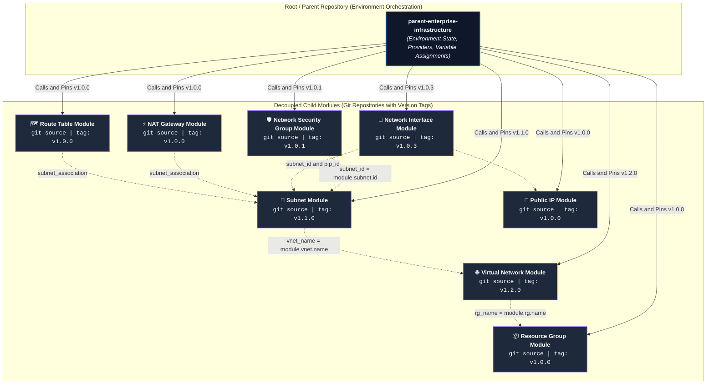
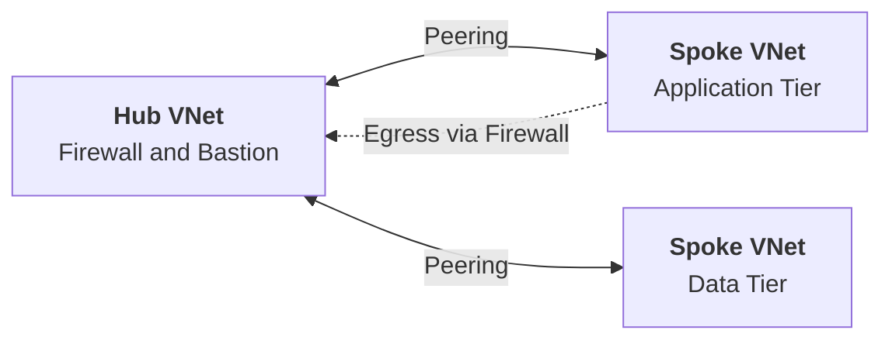
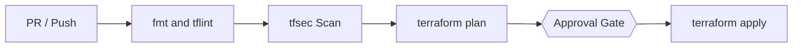

<div align="center">

# ☁️ Gaurav Dubey
### Azure Cloud & DevOps Engineer | Terraform | Infrastructure as Code | CI/CD

<p align="center">
  <a href="https://git.io/typing-svg">
    
  </a>
</p>

<p align="center">
  <a href="https://gauravdubey.pages.dev/">
    
  </a>
  &nbsp;
  <a href="https://www.linkedin.com/in/gauravdubey5">
    
  </a>
  &nbsp;
  <a href="https://github.com/gauravdubey5">
    
  </a>
</p>

<p align="center">
  
  &nbsp;
  
</p>

</div>

---

## 🎯 Executive Summary & About Me

I am an early-career **Azure Cloud & DevOps Engineer** with a **B.Tech in Computer Science & Engineering**, focused on architecting resilient, automated, and secure cloud platforms. My engineering practice centers on **declarative Infrastructure as Code (IaC)**, **immutable delivery pipelines**, and **shift-left security governance**.

```
┌────────────────────────────────────────────────────────────────────────────────────────┐
│                                CORE ENGINEERING PILLARS                                │
├──────────────────────────┬─────────────────────────────┬───────────────────────────────┤
│  ☁️ Cloud Architecture   │  🏗️ Modular Terraform       │  🔄 CI/CD & DevSecOps         │
│  - Azure Virtual Networks│  - Parent-Child Repositories│  - Azure DevOps & GitHub Acts │
│  - Hub-Spoke Topologies  │  - Git Tag Version Pinning  │  - Automated Plan/Apply Gates │
│  - Azure Policy & RBAC   │  - Reusable Child Modules   │  - tfsec, Checkov & TFLint    │
│  - Compute & Storage IaaS│  - Remote State Management  │  - Bash, PowerShell & Linux   │
└──────────────────────────┴─────────────────────────────┴───────────────────────────────┘
```

- **Cloud Infrastructure:** Architecting Microsoft Azure foundations, virtual networking, identity access governance, and resource lifecycle management.
- **Modular Terraform:** Designing decoupled, production-grade Terraform modules featuring clear input/output contracts, immutable Git release tags, and remote state locking.
- **Continuous Delivery:** Engineering multi-stage CI/CD pipelines in Azure DevOps and GitHub Actions with automated code verification and deployment approvals.
- **DevSecOps & Reliability:** Embedding automated security scanning, policy compliance checks, and configuration hygiene into every pull request.

---

## 🛠️ Technical Competency Matrix

<div align="center">

<p align="center">
  
</p>

</div>

| Domain | Core Technologies & Tools | Engineering Scope |
| :--- | :--- | :--- |
| **Cloud Platform** | `Microsoft Azure` `Azure Portal` `Azure CLI` | Virtual Networks (VNets), Hub-Spoke Topology, Resource Groups, Subnets, NSGs, Public IPs, NICs, Route Tables, NAT Gateways, Storage Accounts |
| **Infrastructure as Code** | `Terraform` `HCL` `Terraform Cloud` | Parent-Child Architecture, Custom Modules, Remote State Locking, Dependency Injection, Git Tag Versioning |
| **CI/CD & Automation** | `Azure DevOps` `Azure Pipelines` `GitHub Actions` `YAML` | Multi-stage build/release pipelines, Service Principal authentication, automated approval gates, secret management |
| **Operating Systems** | `Linux (Ubuntu / Debian)` `Windows Server` | System administration, package management, service configuration, file permission hardening |
| **Scripting & Tooling** | `Bash` `PowerShell` `Python` `Git` | Infrastructure automation scripts, CLI wrappers, Git workflows, PR reviews |
| **Containers & Orchestration** | `Docker` `Kubernetes (AKS Fundamentals)` | Containerization, Dockerfile optimization, multi-container stacks, cluster basics |
| **DevSecOps & Code Quality** | `tfsec` `Checkov` `TFLint` `terraform fmt` | Static code analysis, security scanning, policy drift prevention, vulnerability mitigation |

---

## 🏛️ Terraform Architecture Showcase: Parent-Child Pattern

A core hallmark of enterprise Infrastructure as Code is decoupling environment orchestration from underlying resource definitions. In my projects, I implement an enterprise **Parent-Child Terraform Architecture** utilizing dedicated Git repositories, semantic version pinning, and explicit output-to-input parameter binding.

### Architecture Topology Diagram



### Architectural Principles

* **Git-Based Module Sourcing:** Modules are maintained in dedicated repositories or versioned directories, preventing monolithic code drift.
* **Strict Semantic Version Pinning:** Child modules are referenced with immutable Git tags (`?ref=v1.2.0`), guaranteeing reproducible builds across dev, staging, and production environments.
* **Explicit Dependency Mapping:** Downstream modules consume upstream outputs (e.g., `module.rg.name` → `module.vnet.resource_group_name`), ensuring deterministic dependency resolution.
* **Isolated Blast Radiuses:** Changes to individual child modules undergo standalone validation and tagging before adoption by parent root configurations.
* **Automated CI/CD Integration:** Pipelines authenticate via Service Principals or System Access Tokens to clone private module repositories during `terraform init`.

---

## 🚀 Featured Engineering Projects

### 1. Enterprise Azure Landing Zone
**Scalable Cloud Foundation & Hub-Spoke Network Architecture**

An enterprise-ready Azure Landing Zone implementing security baselines, identity controls, and a transit Hub-Spoke network topology managed strictly via Terraform.

* **Hub-Spoke Topology:** Centralized transit network isolating egress firewall and management bastions from application workloads.
* **Governance as Code:** Integration with Azure Policy to enforce regional deployment guardrails and resource tagging.
* **Zero-Trust Network Controls:** Layered Network Security Groups (NSGs) restricting inter-subnet lateral movement.



- **Tech Stack:** `Azure` `Terraform` `Hub-Spoke VNet` `Azure Policy` `DevSecOps`
- **GitHub Repository:** [Enterprise-Azure-Landing-Zone](https://github.com/gauravdubey5/Enterprise-Azure-Landing-Zone)

---

### 2. Terraform Enterprise Infrastructure
**Modular Parent-Child Infrastructure Orchestration**

A production-grade infrastructure deployment framework demonstrating the clean separation of environment orchestration from reusable child modules.

* **Decoupled Architecture:** Reusable child modules for Resource Groups, VNets, Subnets, NSGs, NICs, and Public IPs.
* **Version-Pinned Releases:** Invocations locked via Git semantic tags to prevent breaking changes and unplanned drift.
* **State Isolation:** Remote backend architecture utilizing Azure Blob Storage with state locking and encryption at rest.
* **Automated Validation:** Pre-commit linting and HCL formatting checks integrated into pipeline triggers.

```
parent-infrastructure/
├── main.tf          # Module calls with ?ref=vX.Y.Z
├── variables.tf     # Environment variables
├── outputs.tf       # Exported resource identifiers
└── terraform.tfvars # Environment values
```

- **Tech Stack:** `Terraform` `Azure RM` `Modular IaC` `Git Tags` `Remote State`
- **GitHub Repository:** [terraform-enterprise-infrastructure](https://github.com/gauravdubey5/terraform-enterprise-infrastructure)

---

### 3. GitHub Actions Pipeline Automation
**End-to-End Infrastructure CI/CD with Shift-Left Security**

An automated multi-stage CI/CD workflow designed to validate, test, scan, and deploy cloud infrastructure with zero manual overhead.

* **Static Analysis:** Automated execution of `terraform fmt -check` and `tflint` on every pull request.
* **Security Scanning:** Shift-left security scans powered by `tfsec` to block misconfigurations before code merges.
* **Speculative Plans:** Automated generation and commenting of `terraform plan` summaries directly on pull requests.
* **Protected Deployments:** Manual environment approval gates required prior to production execution.



- **Tech Stack:** `GitHub Actions` `CI/CD` `YAML` `tfsec` `TFLint` `Automation`
- **GitHub Repository:** [pipeline-using-action](https://github.com/gauravdubey5/pipeline-using-action)

---

### 4. SmartLearn AI – Cloud-Native Platform
**Modern Full-Stack Educational Web Application & Containerization**

A responsive cloud-native learning management platform designed with modular application architecture and containerized deployment readiness.

* **Application Architecture:** Developed with Python, Flask, RESTful endpoints, and modern responsive front-end interfaces.
* **Database & Data Layer:** Relational data schemas optimized for student learning metrics and course tracking.
* **Container Packaging:** Dockerized application image optimized for minimal size and rapid deployment to cloud container instances.
* **Deployment Automation:** Integrated CI/CD workflows for automated build, container packaging, and deployment.

```
SmartLearn-AI/
├── app/             # Application controllers & routes
├── models/          # Relational schemas & database logic
├── static/          # Responsive UI assets & styles
└── Dockerfile       # Container packaging configuration
```

- **Tech Stack:** `Python` `Flask` `Docker` `REST APIs` `Cloud Deployment`
- **GitHub Repository:** [SmartLearn-AI](https://github.com/gauravdubey5/SmartLearn-AI)

---

## 📊 GitHub Analytics & Telemetry

<div align="center">

<table border="0" cellpadding="0" cellspacing="0">
  <tr>
    <td align="center" valign="middle">
      <a href="https://github.com/gauravdubey5">
        
      </a>
    </td>
    <td align="center" valign="middle">
      <a href="https://github.com/gauravdubey5">
        
      </a>
    </td>
  </tr>
  <tr>
    <td colspan="2" align="center" valign="middle">
      <br/>
      <a href="https://github.com/gauravdubey5">
        
      </a>
    </td>
  </tr>
</table>

</div>

---

## 🧭 Engineering Focus & Continuous Development

* **Enterprise Kubernetes (AKS):** Exploring production cluster deployment, ingress controllers, Azure CNI networking, and Pod Identity.
* **GitOps & Declarative Delivery:** Deepening knowledge in Git-driven continuous delivery workflows with automated drift correction.
* **Cloud Security & Policy as Code:** Strengthening automated guardrails using Azure Policy, Open Policy Agent (OPA), and Checkov in CI pipelines.
* **Certifications in Progress:** Pursuing continuous Microsoft Cloud certifications (AZ-104: Microsoft Azure Administrator & AZ-400: Microsoft DevOps Solutions).

---

## 🎓 Education & Background

* **Bachelor of Technology (B.Tech)** — Computer Science & Engineering
* **Core Foundation:** Computer Networks, Operating Systems, Cloud Computing, System Architecture, Object-Oriented Programming, and Database Management Systems.

---

## 🤝 Let's Connect & Collaborate

I am actively seeking **DevOps Engineer** and **Azure Cloud Engineer** roles where I can contribute to building resilient, automated cloud infrastructure. Let's discuss cloud architecture, automation, or potential opportunities!

<p align="center">
  <a href="https://www.linkedin.com/in/gauravdubey5">
    
  </a>
  &nbsp;
  <a href="https://gauravdubey.pages.dev/">
    
  </a>
  &nbsp;
  <a href="https://github.com/gauravdubey5">
    
  </a>
</p>

<div align="center">
  <sub>Designed with precision for Cloud & DevOps excellence • © 2026 Gaurav Dubey</sub>
</div>
