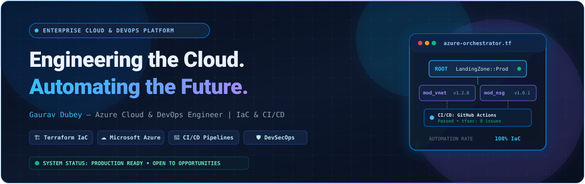
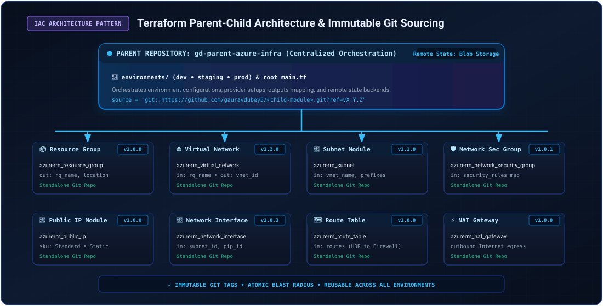
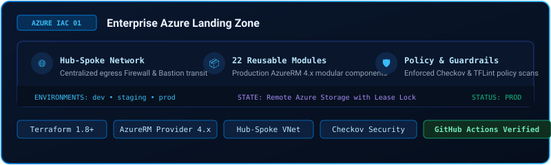
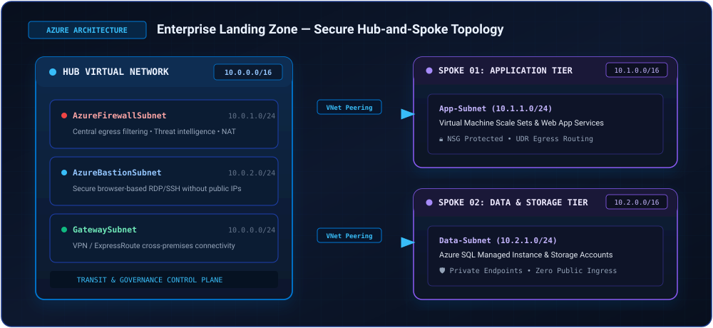
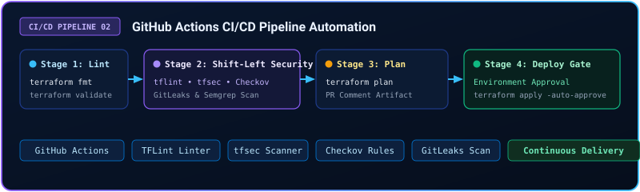
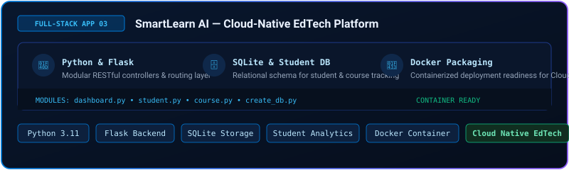

<div align="center">

<!-- HERO BANNER -->
<p align="center">
  
</p>

<!-- ANIMATED TYPING SUB-BANNER -->
<p align="center">
  <a href="https://git.io/typing-svg">
    
  </a>
</p>

<!-- SOCIAL & CONTACT NAVIGATION -->
<p align="center">
  <a href="https://gauravdubey.pages.dev/">
    
  </a>
  &nbsp;
  <a href="https://www.linkedin.com/in/gauravdubey5/">
    
  </a>
  &nbsp;
  <a href="https://github.com/gauravdubey5">
    
  </a>
  &nbsp;
  <a href="mailto:gaurav25eng@gmail.com">
    
  </a>
</p>

<!-- RECRUITER OPPORTUNITY STATUS -->
<p align="center">
  
  &nbsp;
  
  &nbsp;
  
</p>

</div>

---

## 🎯 About Me

I am an **Azure Cloud & DevOps Engineer** with a **B.Tech in Computer Science & Engineering**, specializing in building reproducible, secure, and automated cloud platforms. My engineering approach is anchored in **declarative Infrastructure as Code (IaC)**, **immutable delivery pipelines**, and **shift-left security governance**.

```
┌────────────────────────────────────────────────────────────────────────────────────────┐
│                              SYSTEM ARCHITECTURE & IDENTITY                            │
├──────────────────────────┬─────────────────────────────┬───────────────────────────────┤
│  ☁️ Cloud Architecture   │  🏗️ Modular Terraform       │  🔄 CI/CD & DevSecOps         │
│  - Azure Virtual Networks│  - Parent-Child Repositories│  - GitHub Actions Workflows   │
│  - Hub-and-Spoke Topology│  - Git Tag Version Pinning  │  - Azure DevOps YAML Pipelines│
│  - Azure Firewall & NSGs │  - 22+ Production Modules   │  - TFLint, tfsec, Checkov     │
│  - Compute, Storage, IAM │  - Remote State Locking     │  - GitLeaks & Semgrep Scans   │
└──────────────────────────┴─────────────────────────────┴───────────────────────────────┘
```

### Core Engineering Focus:
* **Microsoft Azure Infrastructure:** Architecting enterprise cloud foundations, network isolation topologies, and identity-driven access controls.
* **Modular Terraform Architecture:** Authoring decoupled, reusable child modules sourced via immutable Git release tags (`?ref=vX.Y.Z`) with explicit output-to-input parameter binding.
* **Continuous Integration & Delivery:** Engineering automated multi-stage pipelines in GitHub Actions and Azure DevOps featuring automated code linting, security scans, speculative planning, and deployment gates.
* **DevSecOps & Code Quality:** Embedding automated security scanning tools (`tfsec`, `Checkov`, `GitLeaks`, `TFLint`) directly into PR workflows to catch misconfigurations before deployment.
* **Linux & Systems Automation:** Proficient in Linux system administration, shell scripting with Bash and PowerShell, and task automation.

---

## 🛠️ Technical Skills Dashboard

<div align="center">
  <p align="center">
    
  </p>
</div>

| Technology Category | Tools & Platforms | Hands-On Engineering Scope |
| :--- | :--- | :--- |
| **Cloud Infrastructure** | `Microsoft Azure` `Azure CLI` `Azure Portal` | Virtual Networks (VNets), Hub-and-Spoke Topology, Azure Firewall, Azure Bastion, Subnets, Network Security Groups (NSGs), Public IPs, NICs, Route Tables (UDR), NAT Gateways, Virtual Machines, Storage Accounts, Key Vault, Azure Monitor |
| **Infrastructure as Code** | `Terraform` `HCL` `Terraform Cloud` | Parent-Child Architecture, Custom Modular Repositories, Remote Backend with State Lease Locks, Dynamic Variables (`map(object)`), `for_each` Deployment, Git Tag Version Pinning |
| **CI/CD Automation** | `GitHub Actions` `Azure DevOps` `YAML` | Multi-stage build & deployment pipelines, Service Principal (SPN) OIDC authentication, automated PR speculative plan commenting, manual approval gates, environment secrets |
| **Security & Quality** | `TFLint` `tfsec` `Checkov` `GitLeaks` `Semgrep` `Terrascan` | Shift-left security scans, automated static code analysis, policy-as-code validation, secret detection, Terraform formatting verification (`terraform fmt -check`) |
| **Containers & Orchestration** | `Docker` `Kubernetes (AKS Fundamentals)` | Containerization, Dockerfile optimization, multi-container compose, Pod & Service lifecycle management, basic cluster architecture |
| **Operating Systems** | `Linux (Ubuntu / Debian)` `Windows Server` | System administration, package management, service configuration, permission hardening, system logs, environment variables |
| **Scripting & Languages** | `Bash` `PowerShell` `Python` `SQL` | Cloud automation scripts, Azure CLI orchestration wrappers, RESTful API controllers, data modeling |

---

## 🏛️ Signature Architecture: Terraform Parent-Child Pattern

A primary hallmark of enterprise Infrastructure as Code is decoupling environment orchestration from underlying resource definitions. In my projects, I implement an enterprise **Parent-Child Terraform Architecture** utilizing dedicated Git repositories, semantic version pinning, and explicit output-to-input parameter binding.

<p align="center">
  
</p>

### Key Architectural Principles:

```
PARENT REPOSITORY (Centralized Orchestration)
gd-parent-azure-infra
│
├── environments/ (dev • staging • prod)
├── main.tf (Module Invocations with ?ref=vX.Y.Z)
├── variables.tf / terraform.tfvars
└── backend.tf (Azure Blob Storage with Lease Lock)
     │
     ├──► 📦 Resource Group Module        (git::https://github.com/.../azurerm-resource-groups.git?ref=v1.0.0)
     ├──► 🌐 Virtual Network Module       (git::https://github.com/.../azurerm-virtual-networks.git?ref=v1.2.0)
     ├──► 🔀 Subnet Module                (git::https://github.com/.../azurerm-subnets.git?ref=v1.1.0)
     ├──► 🛡️ Network Security Group Module (git::https://github.com/.../azurerm-network-security-groups.git?ref=v1.0.1)
     ├──► 📍 Public IP Module             (git::https://github.com/.../azurerm-public-ips.git?ref=v1.0.0)
     ├──► 🔌 Network Interface Module     (git::https://github.com/.../azurerm-network-interfaces.git?ref=v1.0.3)
     ├──► 🗺️ Route Table Module           (git::https://github.com/.../azurerm-route-tables.git?ref=v1.0.0)
     └──► ⚡ NAT Gateway Module           (git::https://github.com/.../azurerm-nat-gateways.git?ref=v1.0.0)
```

1. **Independent Git Repositories:** Each child module lives in its own dedicated, reusable Git repository, preventing monolithic drift and allowing modular team ownership.
2. **Strict Semantic Version Pinning:** Modules are referenced with immutable Git tags (`?ref=v1.2.0`). Updates require explicit version bumps, eliminating surprise breaking changes across environments.
3. **Explicit Dependency Injection:** Child modules declare strictly typed input variables and export deterministic output values (`module.rg.name` $\rightarrow$ `module.vnet.resource_group_name`), enforcing clean boundaries.
4. **Isolated Blast Radiuses:** Changes to an individual child module undergo standalone verification and unit testing before being adopted by root configurations.
5. **Centralized Environment Orchestration:** The parent repository configures environment-specific values (`dev`, `staging`, `prod`) and manages state storage in Azure Blob with lease locks.

---

## 🚀 Featured Engineering Projects

### 1. Enterprise Azure Landing Zone
**Production-Grade Azure Hub-and-Spoke High Availability Infrastructure**

<p align="center">
  
</p>

An enterprise-ready Azure Landing Zone framework built with modular Terraform (AzureRM 4.x), implementing security baselines, identity controls, and transit network routing.

* **Hub-and-Spoke Topology:** Centralized transit network isolating egress firewall, VPN gateway, and management bastions from workload tiers.
* **22 Reusable Infrastructure Modules:** Comprehensive modular library covering Resource Groups, VNets, Subnets, NSGs, Route Tables, NAT Gateways, Azure Bastion, Key Vault, and Application Gateways.
* **Multi-Environment Isolation:** Dedicated environment configurations for `dev`, `staging`, and `prod` with remote state locking in Azure Blob Storage.
* **Governance as Code:** Enforced pre-commit checks with `.checkov.yaml` for security compliance, `.tflint.hcl` for syntax best practices, and `infracost.yml` for cloud cost estimation.

<p align="center">
  
</p>

- **Tech Stack:** `Microsoft Azure` `Terraform 1.8+` `AzureRM Provider 4.x` `Hub-Spoke VNet` `Checkov` `TFLint` `Infracost`
- **GitHub Repository:** [Enterprise-Azure-Landing-Zone](https://github.com/gauravdubey5/Enterprise-Azure-Landing-Zone)

---

### 2. Terraform Enterprise Infrastructure
**Modular Multi-Tier Infrastructure with Dynamic Object Maps**

A production-grade infrastructure deployment framework demonstrating the separation of environment orchestration from reusable child modules.

* **14 Decoupled Infrastructure Modules:** Custom modules for Resource Groups, VNets, Subnets, NSGs, Route Tables, Public IPs, NAT Gateways, Bastions, Load Balancers, Application Gateways, Storage Accounts, Key Vaults, Managed Disks, and VMs.
* **Dynamic Resource Deployment:** Engineered with `map(object)` variable schemas and Terraform `for_each` loops to dynamically provision complex network topologies with clean code.
* **Multi-Tier Segmentation:** Distinct subnet architectures separating public ingress, application compute, and private database tiers.
* **State Management:** Secure state backend backed by Azure Blob Storage with encryption at rest and lease-based concurrency locking.

```
terraform-enterprise-infrastructure/
├── environments/
│   ├── dev/     # Environment-specific tfvars & backend config
│   ├── qa/      # Testing environment orchestration
│   └── prod/    # Production-hardened infrastructure
└── modules/     # 14 standalone reusable Terraform service modules
```

- **Tech Stack:** `Terraform` `Azure RM Provider` `Modular IaC` `for_each` `Map(Object)` `Remote State`
- **GitHub Repository:** [terraform-enterprise-infrastructure](https://github.com/gauravdubey5/terraform-enterprise-infrastructure)

---

### 3. GitHub Actions CI/CD Pipeline Automation
**End-to-End Multi-Stage Infrastructure Pipeline with Shift-Left Security**

<p align="center">
  
</p>

An automated 11-stage continuous integration and delivery pipeline designed to validate, scan, plan, and deploy cloud infrastructure with zero manual friction.

* **Automated Linting & Formatting:** Enforces `terraform fmt -check` and `terraform validate` on every pull request to maintain pristine codebase hygiene.
* **Comprehensive Shift-Left Security Scans:**
  - `TFLint`: Validates AzureRM provider syntax and warns on non-standard configurations.
  - `tfsec`: Identifies infrastructure security vulnerabilities before code merges.
  - `Checkov`: Scans for compliance against CIS benchmarks and Azure security best practices.
  - `GitLeaks`: Inspects commits to eliminate accidental credential or API key leaks.
  - `Semgrep`: Executes static application security testing (SAST) on infrastructure definitions.
* **Speculative Plan Reporting:** Automatically generates and posts `terraform plan` summaries as markdown comments directly on pull requests.
* **Controlled Environment Gates:** Production deployments require manual approvals before triggering `terraform apply`.

- **Tech Stack:** `GitHub Actions` `CI/CD` `YAML` `TFLint` `tfsec` `Checkov` `GitLeaks` `Semgrep` `Terraform`
- **GitHub Repository:** [pipeline-using-action](https://github.com/gauravdubey5/pipeline-using-action)

---

### 4. SmartLearn AI — Cloud-Native EdTech Platform
**Modern Full-Stack Educational Web Platform & Containerized Architecture**

<p align="center">
  
</p>

A responsive cloud-native learning management platform designed with modular application architecture and containerized deployment readiness.

* **Application Architecture:** Developed with Python and Flask, implementing modular controllers for student management, course catalogs, and administrative dashboards.
* **Data Management:** Relational database layer with SQLite schema modeling course registrations, student progress metrics, and performance analytics.
* **Container Packaging:** Production-ready `Dockerfile` optimized for minimal image footprint, multi-environment portability, and cloud container hosting.
* **Automation Ready:** Configured for automated build pipelines, static analysis, and rapid container deployments.

```
SmartLearn-AI/
├── dashboard.py     # Administrative overview & telemetry
├── student.py       # Student enrollment & profile operations
├── course.py        # Curriculum & course catalog management
├── create_db.py     # Relational SQLite database schema initialization
└── Dockerfile       # Container packaging for cloud deployment
```

- **Tech Stack:** `Python 3.11` `Flask` `SQLite` `Docker` `REST APIs` `Containerization`
- **GitHub Repository:** [SmartLearn-AI](https://github.com/gauravdubey5/SmartLearn-AI)

---

## 📊 GitHub Analytics & Telemetry

<div align="center">

<table border="0" cellpadding="0" cellspacing="0">
  <tr>
    <td align="center" valign="middle">
      <a href="https://github.com/gauravdubey5">
        
      </a>
    </td>
    <td align="center" valign="middle">
      <a href="https://github.com/gauravdubey5">
        
      </a>
    </td>
  </tr>
  <tr>
    <td colspan="2" align="center" valign="middle">
      <br/>
      <a href="https://github.com/gauravdubey5">
        
      </a>
    </td>
  </tr>
</table>

</div>

---

## 🧭 Currently Working On & Engineering Roadmap

* 🏗️ **Enterprise Azure Landing Zone:** Expanding Hub-and-Spoke automated deployments with private endpoint DNS zones and customized Azure Policy definitions.
* 📦 **Modular Terraform Library:** Developing standardized, version-pinned child modules across Azure compute, storage, and networking layers.
* 🛡️ **DevSecOps Pipeline Hardening:** Integrating automated drift detection and policy-as-code enforcement using Checkov and OPA in CI/CD workflows.
* ⚡ **Azure DevOps & GitHub Actions:** Optimizing self-hosted runners and pipeline caching to accelerate feedback loops.
* 🐳 **Cloud-Native Kubernetes:** Deepening hands-on practice with Azure Kubernetes Service (AKS), Ingress controllers, and GitOps delivery models.

---

## 🎓 Education & Verified Achievements

* **Bachelor of Technology (B.Tech)** — Computer Science & Engineering
  * *Foundational Focus:* Computer Networks, Operating Systems, Cloud Computing, Database Management Systems, System Architecture.
* **DevOps Internship Completion Certificate** — Hands-on cloud infrastructure automation and deployment workflows.
* **Mentor Appreciation Award** — Recognized for engineering dedication, technical collaboration, and problem-solving.
* **Continuous Professional Learning:** Actively preparing for Microsoft Certified: Azure Administrator Associate (AZ-104) and DevOps Engineer Expert (AZ-400).

---

## 🤝 Let's Connect & Collaborate

I am actively seeking **DevOps Engineer** and **Azure Cloud Engineer** roles where I can help build resilient, automated cloud infrastructure and streamline deployment lifecycles. Let's discuss cloud architecture, automation, or potential opportunities!

<p align="center">
  <a href="https://www.linkedin.com/in/gauravdubey5/">
    
  </a>
  &nbsp;
  <a href="https://gauravdubey.pages.dev/">
    
  </a>
  &nbsp;
  <a href="https://github.com/gauravdubey5">
    
  </a>
  &nbsp;
  <a href="mailto:gaurav25eng@gmail.com">
    
  </a>
</p>

<!-- FOOTER BANNER -->
<p align="center">
  
</p>
